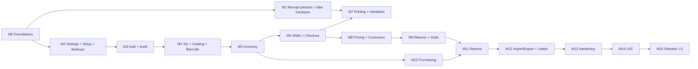

# Roadmap (SDLC phases and milestones)

The developer is an AI, so time isn't the constraint. The order of work is: **build what other things depend on first, and find hardware surprises early**. Each milestone has exit criteria and ends with a build the product owner can try.

**v1.0 is released only when every milestone is done** (everything available from day one). Internal alpha builds start from M6. Every milestone gives the product owner a **Mac build (.dmg)** to try, plus Windows and Linux builds from CI.

## SDLC phases
| Phase | Output | Status |
|---|---|---|
| 0. Planning | [[Project Charter]], [[Scope]], [[Risks]], this roadmap | ✅ Done (this vault) |
| 1. Requirements | `02 Requirements/`: user stories with Given/When/Then acceptance criteria | ✅ Done (to be refined in each milestone) |
| 2. Design | `03 Architecture/`, `04 Decisions/`, `05 Modules/`, `06 Database/`, `07 UI Design/` | ✅ Done (updated as built) |
| 3. Implementation | Milestones M0–M12 below, built test-first (tasks in [[Task Index]]) | ⏳ In progress: M0 done (A0), A1 next |
| 4. Verification | M13 hardening and M14 UAT | — |
| 5. Deployment | M15 release and pilot | — |
| 6. Maintenance | Semantic versions, changelog, every bug fixed with a failing test first | — |

## Milestones

| # | Milestone | Delivers | Exit criteria |
|---|---|---|---|
| **M0** | Foundations | Cargo workspace with all 19 crates (empty), each with its own `CLAUDE.md` (and one in each UI module folder), Tauri + React shell, `core` types (Money, Qty, Bps, Id, AppError), `db` with the migration runner, logging with the runtime switch, ts-rs type generation, CI on 3 OSes, lint and format checks | CI green on Windows, Linux and macOS. The app opens to an empty window on the Mac (and in CI on Windows and Linux). `core` money and rounding tests pass |
| **M1** | Receipt pictures + fake hardware (**no devices needed**) | Draw a sample receipt as a picture at 58 and 80 mm (logo, currency symbol, barcode, QR) and show it in an on-screen **receipt preview window**; a **fake scale** you control from a small panel; a **scan simulator** (type a code or click one from a list); "Print" on any normal printer or Save as PDF through the Mac print dialog | **Product owner approves** the receipt pictures on screen. Real printer, scanner, drawer and scale are tested in M13 |
| **M2** | Settings, setup wizard, backups | `settings`, `tax` (rates CRUD), setup wizard screens, currency/rounding/tax setup, automatic backups, restore, startup integrity check | A fresh install goes through the wizard. Backups are created on a timer and when the app closes, and restore works ([[Req - Setup and Settings]], [[Req - Backup and Logging]]) |
| **M3** | Auth and audit | Users, roles, permissions, PIN/password login, lock screen, lockouts, admin override, recovery code, audit log | Every permission in [[Roles and Permissions]] is enforced in Rust and covered by a test |
| **M4** | Catalog | `catalog` (products, units, categories, brands, barcodes, variants, kits, images, FTS search, archive), `barcode` (EAN check digits, scale-label parsing), product screens | Search returns results in under 150 ms over 50k generated products ([[Req - Catalog]]) |
| **M5** | Inventory | Stock ledger and levels, adjustments, reorder rules, low-stock alerts, batches/expiry/FEFO, stock counts | The ledger-equals-levels check passes after randomized operation tests ([[Req - Inventory]]) |
| **M6** | Shifts and checkout | `shifts`, `sales` carts, scan/search/quantity/remove/cancel, weighed items (manual), scale labels, hold/resume, payments, change, rounding, invoice numbers, the complete-sale workflow | A cashier can sell all day using only the keyboard. Killing the process at any point loses no completed sale. **Alpha build 1** |
| **M7** | Printing and hardware | `printing` (receipt, X/Z report layouts, raster), `hardware` (spooler, TCP, serial, CUPS, scale, drawer), reprint, printing via the system print dialog as a fallback | Receipts match approved golden images, and weighed items work with the fake scale ([[Req - Hardware and Printing]]). **Alpha build 2** |
| **M8** | Pricing and customers | Price lists, tiers, promotions, manual discounts with role limits, customers, loyalty, credit/baki, store credit | All pricing examples in [[Req - Pricing and Promotions]] pass as unit tests |
| **M9** | Returns and voids | Returns with/without receipt, exchanges, voids, reversal of points, credit and stock | Tax and money reverse exactly; this is checked by property tests |
| **M10** | Purchasing | Suppliers, POs, receiving (GRN) with batches and cost updates, supplier returns, payables and payments | [[Req - Purchasing]] passes. Cost updates match [[ADR-018 Moving average cost]] |
| **M11** | Reports | All reports in [[Req - Reports]], with Excel and PDF export | One year of generated data reports in under 3 s |
| **M12** | Import/export, labels, shelf tags | CSV/XLSX import with preview for all entities, exports, barcode label and shelf tag printing (A4 and label printer) | Importing 50k products takes under 60 s. Labels scan correctly on a real scanner |
| **M13** | Hardening + Windows check | Performance tests at full data size, power-cut tests, backup/restore drills, security review, tooltip and colour-code review, **full test pass on a real Windows 10 PC and the first test with real hardware**: receipt printer, cash drawer, barcode scanner, scale, label printer (see [[Printer Setup]], [[Scale Setup]]) | All [[Non-Functional Requirements]] are measured and met |
| **M14** | UAT | **Product owner and a real cashier** run the [[UAT Script]] on real hardware | Zero blocking bugs and zero data-loss bugs |
| **M15** | Release 1.0 | Signed Windows installer, Linux/macOS builds, [[Installation]] runbook, user manuals, pilot at one till | Pilot runs one week without a critical issue |

## How the work is run
Each milestone is split into task briefs ([[Task Index]]), each done by a **fresh cloud session** ([[Building with Cloud Sessions]]).

## Cadence inside each milestone
1. Refine the stories for the milestone in `02 Requirements/` and resolve any open questions.
2. Update the module page(s): API, tables, tests planned.
3. Build test-first ([[TDD Workflow]]).
4. Demo build plus a short demo note in the milestone page (use `Templates/Template - Milestone`).
5. The product owner accepts the milestone, or lists the fixes needed.
