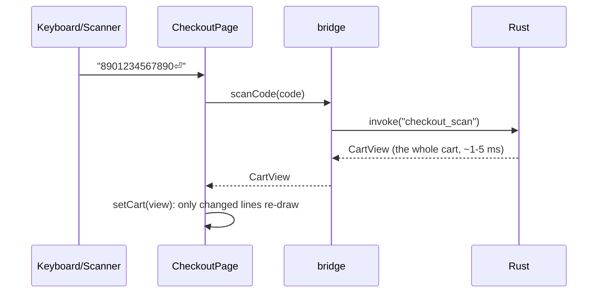

# Frontend Architecture

How the screens are built. Stack: React 19, TypeScript (strict), Vite, Tailwind v4, shadcn/ui (restyled flat), TanStack Query/Table/Virtual, React Router, react-hook-form. Look and feel: [[Design System]].

## Folder layout
```
ui/
├── src/
│   ├── main.tsx                 # start-up: providers and router
│   ├── app/                     # the frame: layout, side menu, routes, lock screen, error screen;
│   │                            #   i18n.ts registers every text namespace (i18next)
│   ├── shared/
│   │   ├── ui/                  # flat components: ActionButton, IconButton, Tip, Field, DataTable, …
│   │   ├── bridge/              # calls into Rust, error-to-message mapping, fake bridge for browser testing
│   │   ├── format/              # formatMoney, formatQty, formatDate (using the shop's settings)
│   │   ├── keyboard/            # the one list of shortcut keys (used with react-hotkeys-hook)
│   │   ├── text/                # i18next settings + shared namespaces (en/common.ts, en/errors.ts)
│   │   └── theme.css            # colour tokens; shadows removed from the theme
│   ├── generated/               # TypeScript types made from the Rust types. Don't edit by hand
│   └── modules/
│       ├── checkout/            # api.ts, text/en.ts, pages/, components/, *.test.tsx
│       ├── catalog/  inventory/  pricing/  customers/  purchasing/
│       ├── shifts/  reports/  io/  setup/  settings/  users/  audit/  backup/  tax/ …
└── e2e/                         # Playwright tests (run against the fake bridge)
```

## Rules
1. **No business maths in TypeScript.** Totals, tax, discounts, stock and permissions all come from Rust. The UI only shows them.
2. **All calls to Rust go through `modules/<x>/api.ts`.** Components never call `invoke` themselves.
3. **Types come from `generated/`.** Never retype a Rust type by hand.
4. **Modules stay separate:** a module folder imports only `shared/`, `generated/` and itself (`eslint-plugin-boundaries` enforces it).
5. **Data from Rust** is loaded and refreshed with TanStack Query. The cart is the exception, see below.
6. **Screen state** (which dialog is open, which line is selected) uses plain `useState`. No global store library.
7. **All screen text lives in the module's `text/en.ts`** (labels, tooltips, messages), in plain English ([[Writing Style]]). Each `text/en.ts` is an **i18next namespace**. Components use `const { t } = useTranslation('checkout')` and `t('holdButton.tip')`. Every namespace is registered in `app/i18n.ts`, and `app/i18next.d.ts` gives TypeScript all the keys, so a wrong key or namespace is a build error (`app/i18n.test.tsx` proves it). Placeholders use i18next's `{{name}}`. **Ready for more languages:** add a `text/<lang>.ts` per module and register it; i18next handles plurals and placeholders (only English exists in v1.0). See [[ADR-022 Ready for more languages later]].
8. **Every button and field has a tooltip.** `ActionButton`, `IconButton` and `Field` require a `tip` prop, so TypeScript refuses code without one.
9. **Flat styling only:** colour tokens from [[Design System]]. The theme has no shadow, blur or gradient utilities, and no animations except the new-line flash.
10. **Money:** shown with `formatMoney(minor)`, built on the browser's `Intl.NumberFormat` (no hand-written grouping). Typed into `<MoneyInput>`, which returns whole minor units.
11. **Libraries first:** check the [[Reuse Map]] before writing a helper (toasts: sonner, command palette: cmdk, shortcuts: react-hotkeys-hook).

## Checkout data flow (the fast path)

- The cart is kept in **one `useState<CartView>`** on the checkout page. Every cart action returns **the whole new cart** from Rust. There's no cart logic in the UI to get wrong.
- The scan box always has focus when no dialog is open. `Enter` sends what was typed to `checkout_scan`, which works out whether it's a barcode, a SKU or a search.
- Search-as-you-type waits 80 ms after the last key press.

## Screens and routing
- **Till mode** (`/checkout`): full screen, no side menu, everything reachable by shortcut keys. Loaded at start-up so it opens instantly.
- **Back office** (`/office/*`): side menu by module. Each section loads when first opened.
- **Setup** (`/setup/*`): shown only until setup is complete.
- Routes hide what a user can't use. This is only for convenience; Rust checks permissions again.
See [[Screen Map]].

## Errors
- Rust sends `AppError` as `{ code, params, field? }`. `errorMessage(error, t)` looks up the plain-English message for `code` in the `errors` namespace (`shared/text/en/errors.ts`), with `t` from `useTranslation('errors')`.
- `OverrideRequired` makes the bridge open the **admin approval** dialog, then repeat the same action with the approval.
- If `field` is set, the message is shown under that field in the form.
- An unexpected error shows "Something went wrong (ref ABC123)" with a "Copy details" button. The details go to the log.

## Fake bridge (fast screen work, also on the Mac)
- `pnpm dev:mock` runs the screens in a normal browser with a fake Rust side (`shared/bridge/mock/`) filled with demo data. Changes show instantly.
- Playwright tests run against it. The real behaviour is covered by Rust tests.
- The fake must match the generated types, so TypeScript catches any mismatch.

## Speed rules
- Lists over 100 rows are virtualized (only visible rows are drawn).
- React Compiler is on. Don't add `useMemo`/`useCallback` by hand without a measured need.
- Product images load as small 96 px thumbnails, only when visible.
- The till-mode code bundle stays under 300 KB (gzipped).
