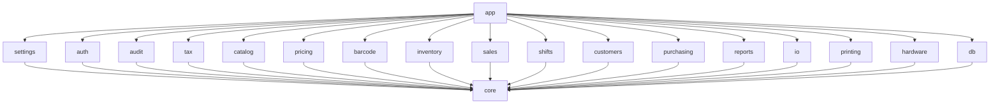

# Module Map

19 crates in one Cargo workspace: `core` (shared types), **15 business modules**, 2 infrastructure crates (`db`, `hardware`), and `app`. The 17 business and infrastructure crates depend only on `core`. `app` connects everything.

| Crate | Purpose | Owns tables | UI folder | Page |
|---|---|---|---|---|
| `core` | Shared types: Money, Qty, Bps, Id, Timestamp, BusinessDate, AppError, Permission, rounding helpers | — | `shared/` | [[Module - core]] |
| `db` | Open/configure SQLite, migration runner, backup, restore, integrity | `db_migrations` | `backup/` | [[Module - db]] |
| `settings` | Typed settings, setup progress | `settings_*` | `setup/`, `settings/` | [[Module - settings]] |
| `auth` | Users, roles, permissions, credentials, overrides, recovery | `auth_*` | `auth/`, `users/` | [[Module - auth]] |
| `audit` | Append-only audit events | `audit_*` | `audit/` | [[Module - audit]] |
| `tax` | Tax rates and components; tax calculation | `tax_*` | `tax/` | [[Module - tax]] |
| `catalog` | Products, variants, kits, barcodes, units, categories, brands, images, search, price history | `catalog_*` | `catalog/` | [[Module - catalog]] |
| `pricing` | Price lists, tiers, promotions; the pricing engine (pure) | `pricing_*` | `pricing/` | [[Module - pricing]] |
| `barcode` | Parse scale labels, check digits, internal barcode generation, barcode images | — (rules live in settings) | — | [[Module - barcode]] |
| `inventory` | Stock ledger, levels, batches, FEFO, adjustments, reorder rules, counts | `inventory_*` | `inventory/` | [[Module - inventory]] |
| `sales` | Carts, holds, sales, payments, payment methods, invoice numbers, returns, voids | `sales_*` | `checkout/`, `sales/` | [[Module - sales]] |
| `shifts` | Shifts, cash movements, denomination counts, shift summaries | `shifts_*` | `shifts/` | [[Module - shifts]] |
| `customers` | Customers, points ledger, credit ledger, balances | `customers_*` | `customers/` | [[Module - customers]] |
| `purchasing` | Suppliers, POs, GRNs, supplier returns, payables ledger | `purchasing_*` | `purchasing/` | [[Module - purchasing]] |
| `reports` | Read-only report queries over published views → `ReportTable` | — | `reports/` | [[Module - reports]] |
| `io` | CSV/XLSX reading and writing, cell parsing, generic tables | — | `io/` | [[Module - io]] |
| `printing` | Document model → raster image → ESC/POS / TSPL bytes; receipt, report, label and tag layouts | — | — | [[Module - printing]] |
| `hardware` | Printer transports, scale reading, device discovery | — | `hardware/` (settings pages) | [[Module - hardware]] |
| `app` | Tauri commands, session, permission guard, workflows, background jobs, wiring | — | `app/` (shell, routing) | [[Module - app]] |

## Who uses whose data (only through `app` workflows)
| Workflow | Modules involved |
|---|---|
| Scan / add line | barcode → catalog → inventory (warning) → sales → pricing → tax |
| Complete sale | sales, pricing, tax, catalog, inventory, shifts, customers, audit, printing, hardware |
| Return / void | sales, inventory, shifts, customers, audit, printing |
| Receive goods | purchasing, inventory, catalog (cost), audit |
| Stock count post | inventory, audit, db (backup) |
| Close shift | shifts, sales (open carts check), reports, printing |
| Import products | io, catalog, inventory, tax, pricing, db (backup) |

Details: [[Workflows]].
