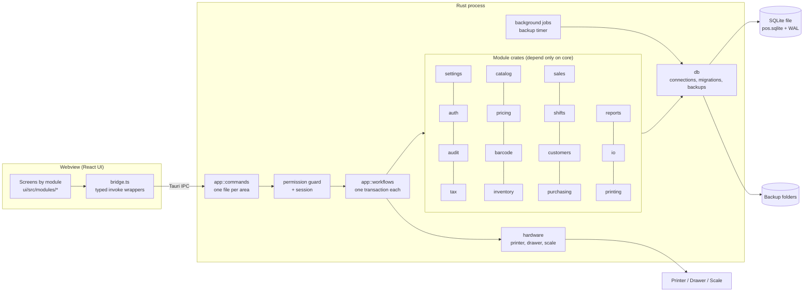

# System Overview

## Big picture

## Layers and their single responsibilities
| Layer | Does | Never does |
|---|---|---|
| **UI** (React) | Shows data, collects input, keyboard handling, formats numbers for display | Calculates totals, tax, stock, permissions |
| **bridge.ts** | Typed wrappers around `invoke()`, turns `AppError` codes into plain-English messages | Business logic |
| **commands** (app) | Deserialize input, look up the session, **check permission**, call one workflow or one module query, serialize output | SQL, business rules |
| **workflows** (app) | Coordinate several modules inside **one transaction**; afterwards trigger hardware (print, drawer) | Own tables |
| **module crates** | Own their tables and rules; pure functions where possible | Call other modules, touch other modules' tables |
| **printing** | Turn receipt/report/label data into a 1-bit image and printer bytes | Talk to devices |
| **hardware** | Send bytes to printers, read scales | Know about sales or receipts |
| **db** | Open the database, set pragmas, run migrations, back up, restore, check integrity | Know any module's schema |

## Runtime
- **One process.** Tauri starts the Rust core and a webview window.
- **Commands run off the main thread.** Every command is `async` and calls the synchronous module code through `spawn_blocking` (the exact Tauri 2 pattern is fixed in M0), so the window never freezes.
- **Database connections:** one **writer** connection (behind a `Mutex`) for all changes, and one **reader** connection for reports and lists. WAL lets them run at the same time. See [[Database Strategy]].
- **Session:** the logged-in user and their permissions are held in Rust state. The UI never sends a user ID to prove who it is.
- **Background jobs:** a thread runs the backup timer. Alerts (low stock, near expiry) are calculated when they're needed (cheap queries), not by a job.

## Startup sequence
1. Start logging (always-on error file log, plus detailed logging if enabled in the last saved settings).
2. Find the app data folder. If there's no database → create it → setup mode.
3. Open the database. `PRAGMA quick_check`. If it fails → recovery screen ([[Req - Backup and Logging]] BAK-06).
4. If migrations are pending → backup (`pre-migrate`) → run migrations for all modules in one transaction per module.
5. Load settings. If setup isn't complete → [[Setup Wizard]].
6. Show login. Preload the checkout screen code.

## Shutdown sequence
1. Refuse to quit while a sale is being saved (it takes milliseconds).
2. Backup (`on-close`) if anything changed since the last backup.
3. `PRAGMA optimize`, close connections (WAL checkpoint).

## Where to read next
- [[Module Map]]: every module and what it owns
- [[Module Rules]]: the boundary rules
- [[Workflows]]: how modules cooperate
- [[Data Conventions]] and [[Money Tax and Rounding]]: how numbers are stored and calculated
