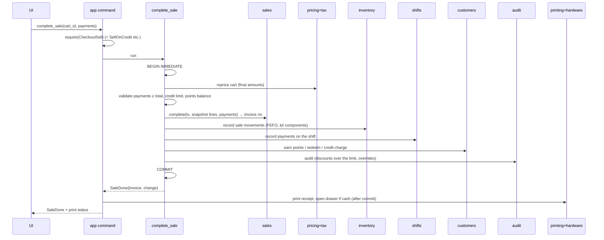

# Workflows

A **workflow** is a use case in `app/src/workflows/` that coordinates several modules. Rules:
- One public function per use case, e.g. `workflows::complete_sale(&ctx, input) -> Result<SaleDone>`.
- Everything that changes data happens in **one transaction** opened by the workflow (`ctx.db.write(|tx| …)`).
- Hardware (print, drawer) runs **after** the commit, and its errors never undo the transaction.
- Every workflow writes its audit events inside the same transaction.
- Integration tests in `app/tests/` cover every workflow, including failure in each step (nothing saved).

`ctx` = `{ db, session, clock, settings snapshot, hardware handles }`.

---

## Scan code
`workflows::cart_lines::scan` (C-M6). Input: raw text from the scan box, optionally `n*` first (`3*890…` adds 3, CHK-04).
1. `barcode::parse(code, scale rules from settings, currency digits)` → `Plain(code)` | `Weighed{item_code, qty}` | `Priced{item_code, price}`
2. Look up the product: `catalog::find_by_code` (barcode, then SKU) / `find_by_scale_code`
   - Not found: digits only → `NotFound { entity: "product_code", key: code }` (CHK-02); words → `Search { hits }` from `catalog::search` (20 at most, with stock and thumbnail; none → not found)
   - Archived products and variant parents are never found (CHK-15)
   - Weighed with a plain code → `NeedsWeight` (the weight dialog then calls `checkout_add_weighed` with the scale or a typed weight; each weighing is its own line)
   - Price sticker: quantity = sticker price ÷ unit price (for stock); the line costs exactly the sticker price (CHK-08)
3. Unit decimals (`qty_decimals_too_many`: no 1.5 pieces), then stock (CHK-21): `inventory::availability` with the local date → refused when "allow negative" is off and the cart would sell more than on hand (`not_enough_stock` with `available_milli`), or when expired batches are set to block (`batch_expired`)
4. `sales::add_line(tx, cart, line, merge)`; merge only when "merge scans" is on and it isn't weighed or a sticker
5. **Reprice the cart** (see below) and return the `CartView` with the line used

The cart is the cashier's open cart on their open shift (`workflows::checkout::current_cart`): made when missing; a cart found on an older shift is held (or dropped when empty). Selling needs the till's open shift to be the user's own (`shift_not_open`, `shift_not_yours`; CHK-20, SHF-02).

## Reprice cart (used after every cart change)
`workflows::cart_view` (C-M6).
1. `sales::get_cart(conn, id)` → lines (product ids, qty, sticker prices, manual discounts, overrides)
2. `catalog::price_info(ids)` → price, cost, tax rate, category path (reversed into top-first for pricing), brand → `pricing::PricingProduct`; `catalog::get` for names, kind and unit
3. `pricing::load_context(conn, products, the attached customer's tier (C-M8), cart price list, local time)` → `pricing::price_cart(ctx, lines, invoice discount)` (pure)
4. `tax::get_many(rate ids)` → `tax::calc_line(amount, rate, mode)` for each line (pure)
5. `core::cash_round(Σ gross, rounding rule)` for the "if paid in cash" total
6. Stock warnings per product (`not_enough_stock`, `expired_batch`; amber, never blocking here)
7. Build the `CartView` (lines with all amounts, totals). Nothing about the price is stored on the cart. **Prices are always recalculated** until completion.

## Complete sale

Failure in any step before COMMIT → rollback; the cart is unchanged.

As built in C-M6 (`workflows::complete_sale`, `payment_amounts`, `sale_snapshot`): the payment dialog calls `checkout_payment_preview` after every change, so the screen never adds money. **Amount due** (SET-06, PAY-06): rounding "for all payments" rounds the gross; "cash only" rounds the part left after non-cash payments when cash pays it, otherwise the gross stands. `sales::settle_payments(due, payments)` gives the applied amounts and the change (only cash may go over). Credit (when selling on credit is on) and points (when loyalty is on) need an attached customer, otherwise `payment_needs_customer`; exchange credit waits for C-M9. Completing: reprice → due → settle (anything left is `payment_not_enough`) → `sales::complete` with one snapshot per line (name, SKU, unit, category, brand, unit and retail price, promotion, each discount, net/tax/gross, rate and its parts from `tax::split_components`, unit cost; a kit's cost is the sum of its parts) → `inventory::record` `sale` rows per product (FEFO, kit parts × kits sold, products that keep no stock skipped, `allow_negative` from settings) → `shifts::record` one `sale_payment` per payment (cash: the amount kept after change) → a fresh cart → COMMIT. No audit event for a plain sale. After the commit, `complete_and_print` prints the receipt and pulses the drawer when cash was taken (C-M7, see "Receipts and printing"); the result is `SaleDone.receipt`.

**With a customer (C-M8):** before saving, points must be whole points (`points_whole_only`) and no more than `customers::max_points_to_redeem` (`points_over_limit`); credit that takes the debt over the customer's limit needs `CreditLimitExceed` or an admin's approval token (`OverrideRequired`). After `sales::complete`, in the same transaction: `customers::add_points` `redeem` for the points paid, `customers::pay_with_credit` for the credit (store credit first, then new debt), and `add_points` `earn` on `eligible_for_points(total, points, credit)` unless the customer opted out. `SaleDone.points_earned` says how many.

## Discounts, typed prices, customer and price list (C-M8)
`workflows::cart_pricing`, each one transaction ending with the repriced `CartView`.
- **Discount** (CHK-12, PRC-07): price the cart, take `pricing::manual_discount_bps`, save the line or invoice discount, price again. If the biggest discount went up and is above the user's own limit (admin unlimited, the role's limit with `DiscountApply`, otherwise 0), an approval token for `DiscountApply` is used up and its admin's own limit must cover it; otherwise `OverrideRequired` and nothing is saved. Approved discounts are audited (`discount.over_limit`, with both users).
- **Typed price** (CHK-13): `require_or_approval(PriceOverride)`, `sales::set_price_override`, audit `price.override` with the old, retail and new unit price.
- **Customer** (CHK-11): `customers::get` (archived refused), `sales::set_customer`; the next price uses the tier's price list and discount.
- **Price list** (CHK-17): `require_or_approval(PriceListSwitch)`, the list must be switched on, `sales::set_price_list`.

## Hold / resume / cancel cart
`workflows::held_carts` (C-M6).
- **Hold:** `sales::hold(tx, cart, note)` → a new empty cart for this shift (CHK-09). An empty cart can't be held.
- **Held list:** `sales::held_carts(till)` with each cart repriced for its total, and the cashier's name (CHK-10).
- **Resume:** `sales::resume(tx, cart, user, shift)` (refused with `cart_in_progress` while the current cart has items; an empty one is dropped) → reprice. Lines whose product's sale price changed after the cart was held (`catalog::price_history`) come back in `price_changed` for the badge.
- **Cancel:** reprice for the snapshot → `sales::cancel(tx, cart)` → audit `cart.cancel` (cart, shift, total, lines with name, quantity and amount) → a new empty cart. An empty cart is left as it is.

## Return items
1. `sales::find_by_invoice` → sale and lines with returnable quantities.
2. Validate quantities. Calculate refunds per [[Money Tax and Rounding#Returns]].
3. `sales::record_return(tx, …)` → return number.
4. `inventory::record` `return` rows (restock lines; write-off lines record `return` then `adjust` with reason damage, so history shows both).
5. `customers`: reverse points; reduce credit if the sale was on credit; add store credit if chosen.
6. `shifts::record` refunds by method.
7. `audit`. COMMIT. Print the return receipt; open the drawer if cash.

## Exchange
Return (as above) with refund method `exchange_credit` → a new cart with a payment line `exchange_credit` of that amount → normal Complete sale. Both documents store the link.

## Void sale
Requires the sale's shift to still be open. `sales::void` → `inventory` `sale_void` rows (the exact opposite of the sale's rows, same batches) → `shifts` reverse payments → `customers` reverse points and credit → `audit` → COMMIT → print the void slip.

## Receive goods (GRN)
1. Validate lines (products exist, batch/expiry for tracked products).
2. For each line: `inventory::on_hand` and `catalog::cost` → `core::moving_average` → `catalog::set_cost`.
3. `inventory::create_batch` (if tracked) + `inventory::record` `receive`.
4. `purchasing::record_grn` → updates PO received quantities/status; payables ledger `invoice` row.
5. `audit`. COMMIT. Offer label printing.

## Supplier return
`purchasing::record_supplier_return` → `inventory::record` `supplier_return` → payables ledger `return_credit` → audit.

## Adjust stock
`workflows::stock::adjust` (C-M5), one transaction: `catalog::get` (a kit, a variant parent or a product with "track stock" off is `product_keeps_no_stock`, INV-09) → the batch: **Auto** is FEFO for stock out and no batch for stock in; **Existing** is that batch; **New** (stock in only, else `new_batch_only_for_stock_in`) needs an expiry date when the product tracks expiry (`expiry_needed`) and is made with `inventory::create_batch` at the product's cost → `inventory::record` `adjust` with the reason, note, the product's cost and `tracks_expiry`, and `allow_negative` from `InventorySettings` (INV-02, INV-04, INV-05) → audit `stock.adjust` (product, quantity, reason, note, batches). Returns the new stock on hand.

## Stock counts (C-M5)
- **Start:** `inventory::create_count` (SC-000001, …) with the scope; a partial count keeps its category, brand and place as JSON for display → audit `stock_count.create`.
- **Count:** `catalog::find_by_code` (barcode, then SKU; `stock_lookup`) → `inventory::record_count_line` (scans add up; the expected stock is kept at the first scan).
- **Review:** `inventory::count_variances` with each product's current `catalog` cost.
- **Post:** refused while a full count has products with stock nobody counted, unless the user confirmed setting them to 0 (`count_uncounted_needs_confirm` with `uncounted`) → backup (`pre-count-post`, before the transaction; a failed backup stops the post) → one transaction: `inventory::post_count` (creates `count` rows for differences) → audit `stock_count.post` (rows written, uncounted set to 0, value of the difference).
- **Cancel:** `inventory::cancel_count` → audit `stock_count.cancel`. Stock doesn't change.

## Stock lists (C-M5)
`workflows::stock::levels` reads the published views `catalog_v_products`, `catalog_v_categories`, `inventory_v_levels` and `inventory_v_batches` in one query: standard products and variants that keep stock (archived ones only while they hold stock), filtered by name or SKU, category (with sub-categories) and Low / Below zero / Expiring; value = on hand × cost (`core::mul_qty`, INV-08). The dashboard's `stock_alerts`: `inventory::low_stock_count` and the 5 biggest shortfalls, `inventory::near_expiry` with `near_expiry_days` (expired batches first), and the number of products below zero. "Verify stock data" is `inventory::verify` with product names; it never fixes anything (INV-10).

## Open / close shift
`workflows::shifts` and `workflows::till` (C-M6). Each is one transaction with its audit event.
- **Open:** float typed, or the count's total → `core::business_date` with the till's cutoff → `shifts::open` (refuses if one is already open on the till) → audit `shift.open` (SHF-01, SHF-02).
- **Cash in / paid-out / cash drop:** amount > 0 and a reason → `shifts::record` with the kind's sign (method `cash`) → audit `shift.cash_move` with the approving admin (SHF-03; `ShiftCashInOut` or an approval token).
- **No-sale drawer:** a reason → audit `drawer.no_sale` (SHF-04; no money moves, so no shift row). After the commit, cash moves and the no-sale pulse the drawer (`cash_move_and_open`, `no_sale_and_open`, HW-04) and return its `PrintResult`.
- **Close:** own shift only (`shift_not_yours`) → refuse if carts with items are open (`sales::open_carts_on_shift(shift)`, `shift_has_open_carts`) → drop the cashier's empty cart → `shifts::close(counts)` (a count is needed) → audit `shift.close` with expected, counted and difference (SHF-06). With "count first" on, `shift_current` hides the expected cash until the count is saved. After the commit the Z report prints (`close_and_print`: `reports::shift_report` → `printing::shift_report`), in `ShiftClosed.report`.
- **Force close:** `ShiftForceClose` or an approval → the owner's cart is held (dropped when empty) → `shifts::close(forced)` (count optional) → audit `shift.force_close` (SHF-07) → after the commit the Z report prints (`force_close_and_print`).
- **X report:** own open shift only → `reports::shift_report` prints "X report – shift still open" (SHF-05). Saves nothing.

## Customer payment (debt)
`customers::credit_ledger` `payment` → if cash at the till: `shifts::record` `customer_payment` → audit → print a payment receipt.

As built in C-M8 (`workflows::customer_records::take_payment`): the method must be active and one of cash, card, wallet or other; a reference when the method needs one. Cash needs the user's open shift; other methods also work from the back office and go on the user's shift when they have one. `customers::add_credit` `payment` (more than owed: `payment_more_than_debt`) → `shifts::record` `customer_payment` → audit `customer.payment` → COMMIT. The payment receipt isn't printed yet (open item on [[Module - app]]).

## Supplier payment
`purchasing` payables `payment` → if cash from the drawer: `shifts::record` `cash_out` → audit.

## Import products
Backup (`pre-import`) → `io::read_table` → map rows to `catalog::NewProduct`/`UpdateProduct` + `inventory::ReorderRule` + `pricing` prices → validate everything → **one transaction** → audit with counts.

## Save product (back office)
`workflows::products::save` (C-M4), one transaction: the tax rate must exist and be active (none picked → the shop's default, `tax_rate_missing` if there is none) → the preferred supplier must exist (`purchasing::get_supplier`) → barcodes are trimmed, repeats dropped, and codes that look like EAN-8, UPC-A or EAN-13 must have the right check digit (`barcode::is_valid_gtin`, else `barcode_check_digit_wrong`; CAT-04) → `catalog::create_product`, or `catalog::update_product` (writes price history, CAT-09) and the barcodes made to match the list (removed, then added) → `inventory::set_reorder_rule`, or `remove_reorder_rule` when there is none or the product holds no stock → audit `product.create` / `product.change` (name, SKU, the price changes). The command also needs `CatalogPriceEdit` when a price changes.

## Product actions (C-M4)
Each is one transaction with its audit event (`product.archive`, `product.unarchive`, `product.change`, `product.delete`).
- **Archive / bring back:** `catalog::archive_product` / `unarchive_product` (CAT-08).
- **Delete:** used = `sales::is_product_used` or `inventory::is_product_used` or `purchasing::is_product_used` → `catalog::delete_unused_product(used)` (also refuses kit parts and parents with variants) → `inventory::remove_reorder_rule`.
- **Make shop barcode** (CAT-11): `catalog::next_internal_number` → `barcode::internal_ean13(InternalBarcode.prefix, number)` → `catalog::add_barcode`; a number already typed by hand on another product (`barcode_in_use`) is skipped and the next is tried.
- **Generate variants** (CAT-06): values trimmed, empty ones dropped → `catalog::generate_variants`.
- **Kit parts** (CAT-07): `catalog::set_kit_components`.
- **Picture** (CAT-10): `catalog::set_image(source, <data>/images)`. `product_get` returns the 512 px picture as a `data:image/jpeg;base64,…` address.
- **Units, categories, brands** (CAT-02, CAT-03): `workflows::catalog_lists`, audited `unit.change`, `category.change`, `brand.change` (create, update or archive).

## Startup
`app::startup::start(paths, clock)`: make the data, `backups` and `logs` folders → finish a restore asked for before the restart (`restore-pending.json`: delete the database, its `-wal` and `-shm`, copy the backup in, remove the marker first so a failed restore never repeats) → `Db::open` → `db::quick_check` (a failure, or a file SQLite can't open, gives `DbHealth::Damaged`: only the recovery screen works, BAK-06) → if an existing database has pending migrations, `db::backup_to(backups/…-pre-upgrade.sqlite)` → `db::migrate` → audit the restore (`backup.restore`) **into the restored database**. Logging starts first (warnings and errors), then the saved `LoggingSettings` switch the detail on. The backup timer starts only for a healthy database.

## Backups
`workflows::backup::make_backup(state, reason)`: main folder (settings, or the app's `backups` folder) → `db::backup_to` (VACUUM INTO + check; a failed check sets the `backup_check_failed` banner) → `db::prune_backups` (newest `keep_last` + last of each day for 30 days) → copy to the second folder and prune there (a failure only sets the `backup_second_folder_failed` banner, BAK-02). A second backup in the same second gets `-2` after its reason. The timer (`jobs.rs`, every 30 s it checks whether `interval_min` has passed) calls `backup_if_changed`, which skips when `db::has_changed_since` is false. Closing the app always backs up (`close`) once setup is complete. "Back up now" audits `backup.manual`.

## Restore backup
`db::verify(file)` → backup current (`pre-restore`, skipped when the database is damaged) → write `restore-pending.json` (file, user, and the admin who approved it if the user lacked `BackupRestore`) → restart. The swap happens at the next start (see Startup), and the audit event is written into the restored database there.

## Test print
`workflows::test_print::run(printer, paper, fonts)`: sample receipt data (sample shop, a sample logo, a Code 128 barcode from `barcode::bitmap`, a QR code) → `printing::receipt` with the English `ReceiptLabels` (`app::receipt_words`) → `printing::rasterize` → `printing::escpos::encode` (cut, no drawer) → `printer.send`. Saves nothing, so there is no transaction. A printer error comes back as `AppError::Hardware` (HW-08). The printer is the saved receipt printer (`Devices::receipt_printer`, Preview until one is chosen, C-M7); the shop details are still samples.

## Receipts and printing (C-M7)
`workflows::receipts`. Nothing here saves sale data, so a printer problem never undoes anything (HW-08).
- **What prints:** a `Printable` is a sale's receipt or a shift's report. The receipt is read back from the saved sale (`sales::get_sale`, ADR-011) and the settings: shop header, logo (`logo_path`; a missing or broken file prints none), header and footer lines, item lines (pieces without a unit), line discounts, subtotal, invoice discount, rounding, total, payments (cash as tendered, with the change), tax summary per rate, the invoice barcode, and the cashier's and till's names. A report is `reports::shift_report` with the user, till and payment method names and the clock's offset.
- **Sending:** draw (`printing::rasterize`) → `escpos::encode` (cut; the drawer pulse with the first copy when asked) → `Devices::send` to the saved printer, one printout at a time. A new receipt prints `copies` times (1–3); a reprint or a report once.
- **Failure (PAY-09):** the error is logged, the `Printable` is remembered in `Devices` (memory only) and returned in `PrintResult`. The screen shows the banner: Retry (`print_retry`; a receipt that took cash pulses the drawer again), "Print to system printer" (`print_system_pictures` → PNG → `print_window`, HW-07), Close (`print_dismiss`). These work only for a remembered printout (`print_not_waiting`); a printout that prints is forgotten.
- **Reprint (PAY-10):** the till's last sale (`sales::last_sale`, `ReceiptReprintLast`) or an invoice number (`sales::find_by_invoice`, `ReceiptReprintAny`) → audit `receipt.reprint` → print with `copy: true` ("COPY" at the top), no drawer.
- **Drawer (HW-04):** `escpos::drawer_pulse(pin)` with the saved pin, through the receipt printer. On the Preview printer it shows as "Drawer opened".
- **Scale (HW-05):** `Devices::scale` reads the saved scale (port, speed, built-in profile; 8N1) with `hardware::scale_from`; with no saved scale, dev builds use the fake scale and release builds ask for a typed weight.

## First-run setup
Each wizard step saves through `settings` (and `tax`, `auth`) in its own transaction together with `settings::complete_step` (`workflows::setup`), and is refused once setup is complete (`setup_already_done`). Shop → money (also fills the denominations from `suggested_denominations` if empty) → tax (the rates are added first with `tax_rate_save`; at least one is needed, the default must be one of them, `None` takes the first) → admin (`auth::create_user` with the Admin role + `auth::create_recovery_code`, then the admin is signed in) → till (gets its `till_id` once; the code is trimmed and upper-cased) → hardware (printer, paper width, drawer pin; can be skipped) → backup (folders must be writable) → products ("Add later" only for now). Setup itself isn't audited: there is no till yet. Invoice sequence rows are made by `sales` on first use, so setup makes none.

## Settings change
`workflows::settings_change::save`: one section per call, in one transaction; each setting saved is audited (`settings.change`, details `{key, old, new}`, the old value being the one in use, the default if never saved). Money: refused with `minor_digits_locked` when the number of decimals changes and `sales::has_any_sale` (SET-05). Tax: the default rate must exist. Till: keeps its id. Backup: folders must be writable. Detailed logging is saved, audited (`logging.switch`) and applied at once.

## Login (C-M3)
`session::login(state, user_id, secret)`: refused with `till_locked` while another user's till is locked → in one transaction `auth::verify_login` (PIN **or** password) and its audit event: `session.login` when it worked, `user.lockout` on the fifth wrong try (USR-02). The transaction is committed for every outcome, so the failure count is kept. Then the session is set in memory and any unused approvals are dropped. `logout` audits `session.logout` (also "Switch user" on the lock screen). Login, the tiles and recovery need a finished setup (`setup_not_done`).

## Lock and unlock (C-M3)
`lock` (F12, the Lock button or the idle timer, `checkout.idle_lock_min`) only marks the session locked; nothing is saved. While locked every guarded command answers `till_locked`. `unlock(secret)` checks the locked user's own PIN or password like a login (lockout audited). `unlock_by_admin(username, password)` uses `auth::verify_override` with `UsersManage` and audits `session.unlock_by_admin` (user = the locked user, approved by = the admin); the same user stays signed in (USR-03).

## Admin approval (C-M3)
`request_override(permission, username, password)` → `auth::verify_override` (password only, the approver needs the permission) → audit `approval.granted` (user, approved by, permission) → a random 128-bit token in memory: one permission, the requesting user, 60 seconds. A command that accepts approvals calls `session::require_or_approval(state, permission, token)`: with the permission it runs; otherwise a fitting token is used up (single use, even when it doesn't fit) and the action runs with `approved_by`; otherwise `OverrideRequired`, and the screen shows the approval dialog and runs the action again with the token (USR-05). Logging in, out or locking drops unused tokens. So far only `backup_restore` takes a token.

## Users and roles (C-M3)
`workflows::users::save_user`: new user → `auth::create_user` (+ disable if not active), audit `user.create`; existing → `auth::update_user` + `auth::set_secret` for a typed PIN or password, audit `user.change` (details: name, role, active, `pin_reset`, `password_reset`; never the secrets). `save_role`: `auth::create_role` / `auth::set_role_permissions`, audit `role.create` / `role.change`. One transaction each, so a refusal (`last_active_admin`, `pin_format`, `admin_role_fixed`, …) saves nothing. Every permission check reads the user again (`auth::session_user`), so a changed role or a disabled user counts at once.

## Change own PIN or password (C-M3)
`change_own_secret(kind, current, new)`: `auth::verify_login` with the current one, then `auth::set_secret`, and audit `user.own_secret_change` (details: `kind`), in one transaction (USR-07). Wrong tries count toward the lockout.

## Recovery code (C-M3)
`recover_admin(code, username, password, password_again)`: the two passwords must match → the username must belong to a user → `auth::reset_with_recovery` (an active admin only; the new password; a new code) + audit `recovery.used`, in one transaction. The new code is shown once (USR-09).

## Audit log (C-M3)
`audit_query(filter, page)` → `audit::query` plus every user's name and every action name (`audit_actions::ALL`). `audit_export(filter, file)` pages through every matching event (500 at a time) and writes one sheet with `io::write_xlsx`: local time, business date, till, user and approver names, action, item, details (USR-08). Read only.
