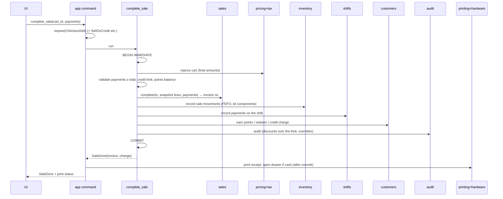

# Workflows

A **workflow** is a use case in `app/src/workflows/` that coordinates several modules. Rules:
- One public function per use case, e.g. `workflows::complete_sale(&ctx, input) -> Result<SaleDone>`.
- Everything that changes data happens in **one transaction** opened by the workflow (`ctx.db.write(|tx| …)`).
- Hardware (print, drawer) runs **after** the commit, and its errors never undo the transaction.
- Every workflow writes its audit events inside the same transaction.
- Integration tests in `app/tests/` cover every workflow, including failure in each step (nothing saved).

`ctx` = `{ db, session, clock, settings snapshot, hardware handles }`.

---

## Scan code
Input: raw code from the checkout input.
1. `barcode::parse(code, &rules)` → `Plain(code)` | `Weighed{item_code, qty}` | `Priced{item_code, price}`
2. Look up the product: `catalog::find_by_barcode` / `find_by_sku` / `find_by_scale_code`
   - Not found → `AppError::NotFound` (UI shows CHK-02)
   - Variant parent → error "choose a variant"
   - Weighed with a plain code → return `NeedsWeight` (UI opens the weight dialog, then calls `add_line` with qty)
3. `inventory::available(product)` → a warning if ≤ 0 or an expired batch (block if the settings say so)
4. `sales::add_line(tx, cart, line)` (or merge into the existing line)
5. **Reprice the cart** (see below) and return a `CartView`

## Reprice cart (used after every cart change)
1. `sales::cart(conn, id)` → lines (product ids, qty, manual discounts, overrides)
2. `catalog::price_info(ids)` → price, tax rate, category path, brand (mapped by app into `pricing::PricingProduct`)
3. `pricing::load_context(conn, ids, tier, price_list, now)` → `pricing::price_cart(ctx, lines)` (pure)
4. `tax::rates(ids)` → `tax::calc_line` for each line (pure)
5. `core::cash_round(subtotal, settings)`
6. Build the `CartView` (lines with all amounts, totals). Nothing about the price is stored on the cart. **Prices are always recalculated** until completion.

## Complete sale

Failure in any step before COMMIT → rollback; the cart is unchanged.

## Hold / resume / cancel cart
- **Hold:** `sales::hold(tx, cart, note)` → a new empty cart for this shift.
- **Resume:** `sales::resume(tx, cart)` (if the current cart is empty; otherwise the user must hold it first) → reprice.
- **Cancel:** `audit::record(cart snapshot)` → `sales::cancel(tx, cart)`.

## Return items
1. `sales::find_by_invoice` → sale and lines with returnable quantities.
2. Validate quantities. Calculate refunds per [[Money Tax and Rounding#Returns]].
3. `sales::record_return(tx, …)` → return number.
4. `inventory::record` `return` rows (restock lines; write-off lines record `return` then `adjust` with reason damage, so history shows both).
5. `customers`: reverse points; reduce credit if the sale was on credit; add store credit if chosen.
6. `shifts::record` refunds by method.
7. `audit`. COMMIT. Print the return receipt; open the drawer if cash.

## Exchange
Return (as above) with refund method `exchange_credit` → a new cart with a payment line `exchange_credit` of that amount → normal Complete sale. Both documents store the link.

## Void sale
Requires the sale's shift to still be open. `sales::void` → `inventory` `sale_void` rows (the exact opposite of the sale's rows, same batches) → `shifts` reverse payments → `customers` reverse points and credit → `audit` → COMMIT → print the void slip.

## Receive goods (GRN)
1. Validate lines (products exist, batch/expiry for tracked products).
2. For each line: `inventory::on_hand` and `catalog::cost` → `core::moving_average` → `catalog::set_cost`.
3. `inventory::create_batch` (if tracked) + `inventory::record` `receive`.
4. `purchasing::record_grn` → updates PO received quantities/status; payables ledger `invoice` row.
5. `audit`. COMMIT. Offer label printing.

## Supplier return
`purchasing::record_supplier_return` → `inventory::record` `supplier_return` → payables ledger `return_credit` → audit.

## Adjust stock
`inventory::record` `adjust` with reason → audit.

## Post stock count
Backup (`pre-count-post`) → `inventory::post_count` (creates `count` rows for differences) → audit.

## Open / close shift
- **Open:** `shifts::open` (refuses if one is already open on the till).
- **Close:** refuse if open carts exist (`sales::open_carts(shift)`) → `shifts::close(counts)` → `reports::shift_report` → print the Z report.

## Customer payment (debt)
`customers::credit_ledger` `payment` → if cash at the till: `shifts::record` `customer_payment` → audit → print a payment receipt.

## Supplier payment
`purchasing` payables `payment` → if cash from the drawer: `shifts::record` `cash_out` → audit.

## Import products
Backup (`pre-import`) → `io::read_table` → map rows to `catalog::NewProduct`/`UpdateProduct` + `inventory::ReorderRule` + `pricing` prices → validate everything → **one transaction** → audit with counts.

## Save product (back office)
`catalog::create/update` + `inventory::set_reorder_rule` + `catalog` price history (if prices changed) + audit, in one transaction.

## Restore backup
`db::verify(file)` → backup current (`pre-restore`) → `db::restore(file)` → audit is written **into the restored database** after restart (the event is stashed in a small file and replayed on next start) → restart.

## Test print
`workflows::test_print::run(printer, paper, fonts)`: sample receipt data (sample shop, a sample logo, a Code 128 barcode from `barcode::bitmap`, a QR code) → `printing::receipt` with the English `ReceiptLabels` (`app::receipt_words`) → `printing::rasterize` → `printing::escpos::encode` (cut, no drawer) → `printer.send`. Saves nothing, so there is no transaction. A printer error comes back as `AppError::Hardware` (HW-08). Until printer settings are saved (C-M2, C-M7) the printer is always the Preview printer, and the shop details are samples.

## First-run setup
Each wizard step saves through `settings` (and `tax`, `auth`) in its own transaction, then `settings::complete_step`. The last step creates the first sequence rows and marks setup complete.
