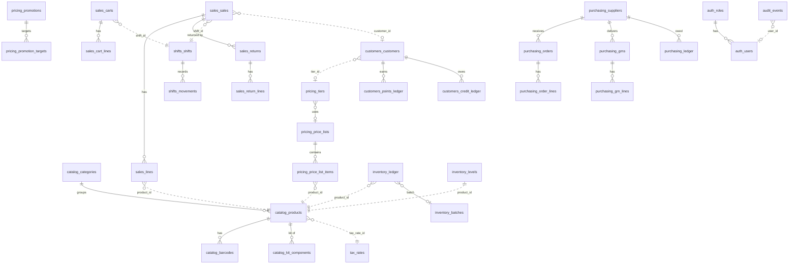

# Database Overview

**Each module page holds the exact SQL for its tables.** This page only gives the map. Strategy: [[Database Strategy]]. Conventions: [[Data Conventions]].

## Logical model (dotted = cross-module reference by id, no SQL FK)

## Table index
| Module | Tables | Published views |
|---|---|---|
| db | db_migrations | — |
| settings | settings_values, settings_setup_steps | — |
| auth | auth_roles, auth_role_permissions, auth_users, auth_recovery | — |
| audit | audit_events | audit_v_events |
| tax | tax_rates, tax_rate_components | tax_v_rates |
| catalog | catalog_units, catalog_categories, catalog_brands, catalog_products, catalog_product_attributes, catalog_barcodes, catalog_kit_components, catalog_price_changes, catalog_sequences, catalog_search (FTS5) | catalog_v_products, catalog_v_categories |
| pricing | pricing_price_lists, pricing_price_list_items, pricing_tiers, pricing_promotions, pricing_promotion_targets | pricing_v_promotions |
| inventory | inventory_batches, inventory_ledger, inventory_levels, inventory_reorder_rules, inventory_reasons, inventory_counts, inventory_count_lines, inventory_sequences | inventory_v_levels, inventory_v_ledger, inventory_v_batches |
| sales | sales_payment_methods, sales_sequences, sales_carts, sales_cart_lines, sales_sales, sales_lines, sales_returns, sales_return_lines, sales_payments | sales_v_sales, sales_v_lines, sales_v_return_lines, sales_v_payments |
| shifts | shifts_shifts, shifts_movements, shifts_counts | shifts_v_shifts, shifts_v_movements |
| customers | customers_customers, customers_points_ledger, customers_credit_ledger, customers_balances, customers_search (FTS5) | customers_v_customers, customers_v_credit_ledger |
| purchasing | purchasing_suppliers, purchasing_orders, purchasing_order_lines, purchasing_grns, purchasing_grn_lines, purchasing_returns, purchasing_return_lines, purchasing_ledger, purchasing_balances, purchasing_sequences | purchasing_v_payables, purchasing_v_ledger, purchasing_v_grn_lines |

## Append-only tables (UPDATE/DELETE blocked by triggers)
`audit_events`, `inventory_ledger`, `shifts_movements`, `customers_points_ledger`, `customers_credit_ledger`, `purchasing_ledger`.

## Cache tables (must equal the sum of their ledger)
| Cache | Ledger |
|---|---|
| inventory_levels, inventory_batches.on_hand_milli | inventory_ledger |
| customers_balances | customers_points_ledger, customers_credit_ledger |
| purchasing_balances | purchasing_ledger |

## Views are contracts
A view is the module's public read API. Changing a view's columns follows [[Module Rules#R5. Changing a public API or view]].
