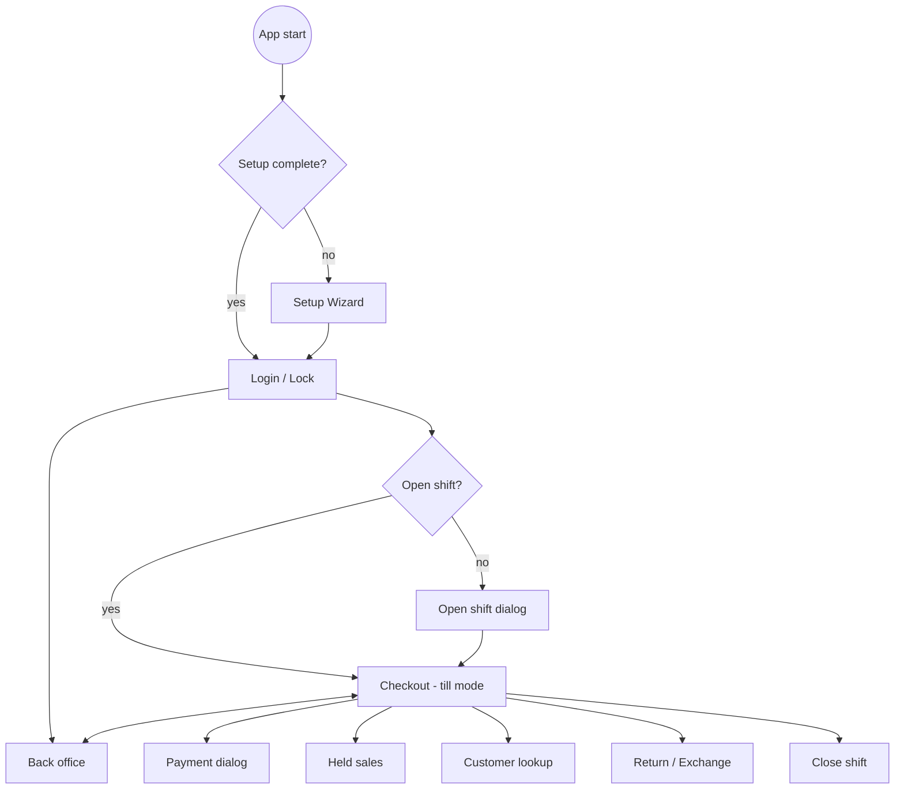

# Screen Map

> The redesign works from the full, numbered list of screens in [[Page List]] (with one spec per page). This map shows how the screens connect.

## Till mode (`/checkout`)
| Screen / dialog | Purpose | Spec |
|---|---|---|
| Checkout | Scan, cart, totals | [[Checkout Screen]] |
| Payment | Methods, tendered, change, complete | [[Checkout Screen#Payment dialog]] |
| Weight | Live scale or manual weight | [[Checkout Screen#Weight dialog]] |
| Held sales | List and resume | [[Checkout Screen]] |
| Customer lookup | Phone search, quick create | [[Checkout Screen]] |
| Return / exchange | Invoice lookup, select lines | [[Back Office Screens#Returns]] |
| Admin approval | Admin enters their password to allow one action | [[Checkout Screen#Admin approval dialog]] |
| Shift open / cash in-out / X / close | Shift cash | [[Back Office Screens#Shifts]] |

## Back office (`/office/*`), side navigation
| Section | Screens | Permission |
|---|---|---|
| Dashboard | Today's sales, alerts (low stock, near expiry, negative stock, backup warnings) | any |
| Products | List, edit, variants, kits, categories, brands, units, labels, shelf tags | CatalogManage / LabelsPrint |
| Pricing | Price lists, tiers, promotions | PricingManage |
| Inventory | Stock levels, history, adjustments, batches, counts | StockView / StockAdjust / StockCount* |
| Purchasing | Suppliers, POs, receive goods, supplier returns, payments | PurchasingManage |
| Customers | List, profile (history, points, credit), statements | CustomerViewCreate / CustomerManage |
| Sales | Sales journal, receipt viewer, returns list | ReportsViewAll |
| Reports | All reports | ReportsViewAll (cashier: own shifts) |
| Import / Export | Wizard per entity | DataImport / DataExport |
| Users & roles | Users, roles, permissions | UsersManage |
| Settings | Shop, currency, tax, receipt, hardware, payment methods, denominations, checkout, inventory, loyalty, credit, backups, logs, barcode rules | SettingsManage / TaxManage |
| Audit log | Filterable list | AuditView |
| Backups | List, back up now, restore | BackupRun / BackupRestore |

Details: [[Back Office Screens]]. Shortcuts: [[Keyboard Shortcuts]]. Visual rules: [[Design System]].
