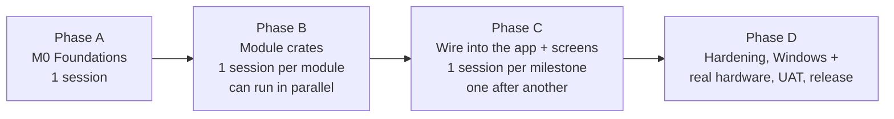

# Building with Cloud Sessions

How the app gets built on GitHub with Claude cloud sessions (claude.ai/code). The key rule: **one task = one fresh session.** A new session starts with an empty memory, so it focuses on one module and can't be confused by earlier work.

## The rules
1. **One task per session, always a fresh session.** Never continue an old session for a different task. If a task turns out too big, finish a clean part, open a pull request, and start a new session for the rest.
2. **A session reads only what its task needs:**
   - its task brief in `docs/12 Tasks/`
   - the module's page in `docs/05 Modules/` (especially "Working on this module")
   - the module folder's `CLAUDE.md`
   - [[Module Rules]], [[Module - core]], [[Coding Standards]], [[Writing Style]]
   It should **not** read other modules' code or pages unless the brief says so.
3. **No hand-over is needed.** Modules are independent, and each module page is the contract: its tables, functions and "Working on this module" instructions. The only duty is to **keep the module page true to the code**. Anything unfinished goes under **"Open items"** on that page.
   The only ordering rules: A0 and then A1 are merged before anything else, and a C task starts after the module crates it connects are merged (listed in its brief as `depends_on`).
4. **One branch and one pull request per task.** Branch name: `task/<brief-id>` (e.g. `task/B-catalog`).
5. **The product owner merges.** CI must be green. The session's pull-request description says what was done, which requirement IDs are covered, and anything left open.

## Build phases

| Phase | What | Sessions | Order |
|---|---|---|---|
| **A** | A0 (M0): workspace, 19 empty crates each with `CLAUDE.md`, app shell, `core`, CI, cloud setup script. A1: swap hand-written parts for standard tools ([[Reuse Map]]) | 1 each | First, one after the other |
| **B** | Each module crate's Rust code and tests, exactly as its page describes. No `app` wiring, no screens | 1 per module | **In parallel**, because module crates depend only on `core` |
| **C** | For each milestone M2–M12: workflows and commands in `app`, plus that module's screens | 1 per milestone | One after another, in [[Roadmap]] order |
| **D** | M13–M15: hardening, Windows PC and real-hardware tests, UAT, release | as needed | Last |

Briefs for every task are in `docs/12 Tasks/`. See [[Task Index]].

## Starting a session (copy this)
> Do task **`<brief id>`**. Read `docs/12 Tasks/<brief file>` first and follow it exactly. Work only inside the folders it names. Write tests first. When finished, fill in the brief's "Result" section, update the module page, and open a pull request.

## Merge conflicts between parallel sessions
Phase B sessions only touch their own `crates/<name>/` folder and their own module page, so they don't collide. The shared files (`Cargo.lock`, `CHANGELOG.md`) may conflict. Resolve these by merging `main` into the branch before merging the pull request; the session can do this when asked.

## Costs to keep low
- CI runs Linux tests on every push. Windows runs on pull requests. The Mac app is built per milestone or on request (a `build-mac` label on the pull request), because Mac and Windows build minutes use up GitHub's allowance faster.
- Sessions run module tests only (`cargo nextest run -p <name>`) while working. The full test suite runs in CI.
